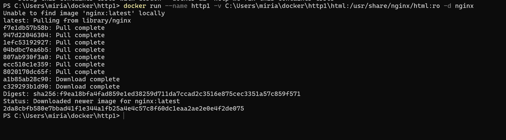
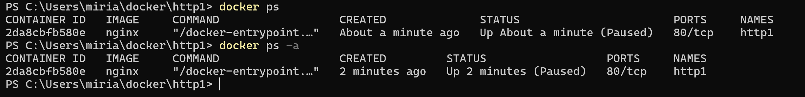

# Docker

Zuerst sollte Docker von der offiziellen Website installiert werden. 
Das Anmelden ist hier nicht notwendig, sonst liegt ein Fehler vor.

Docker ist eine Software, mit der Anwendungen zusammen mit allen benötigten Dateien und Einstellungen in Containern verpackt werden können. 
Dadurch läuft die Anwendung auf jedem Computer gleich, unabhängig vom Betriebssystem oder den installierten Programmen. 
Docker erleichtert die Entwicklung, das Testen und die Bereitstellung von Software.

### Docker HUB
[Dockerhub](https://hub.docker.com)

Der Docker Hub ist eine Bibliothek für Docker - Images

Beispiel **Ubuntu**:


```markdown
docker run ubuntu
```

1. Docker prüft, ob das Ubuntu-Image bereits auf deinem Rechner vorhanden ist.
2. Falls nicht, wird das Image von Docker Hub heruntergeladen.
3. Aus diesem Image erstellt Docker einen Container.
4. Der Container startet und enthält ein minimales Ubuntu-System mit Dateisystem, Programmen und Einstellungen.
5. Der Container nutzt aber nicht seinen eigenen Kernel, sondern den Kernel deines Host-Betriebssystems.


So wird ein neues **Linux** gestartet:
```markdown
docker run -it ubuntu bash
````



dass **ro** steht für *Read Only* 
**-v** zeigt die Verbindung zu unserem Ordner an 
**-d** befiehlt, dass er af der konsole bleibt und sich nicht gleich schließt 


mit docker rm xxx wird der container gelöscht
mit docker stop xxx wird der container gestoppt


