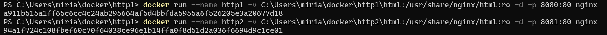
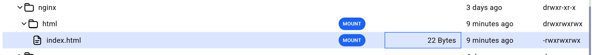
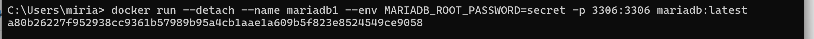
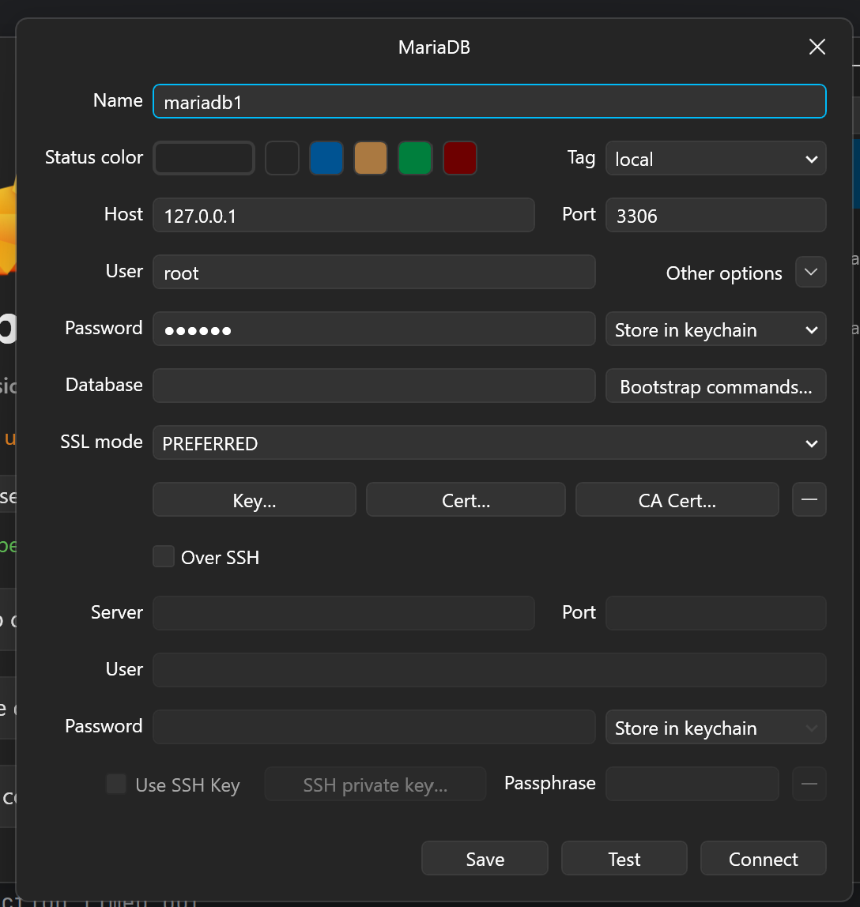

# Docker

Zuerst sollte Docker von der offiziellen 
Website
installiert werden. 
Das Anmelden ist hier nicht notwendig, sonst liegt ein Fehler vor.

Docker ist eine Software, mit der Anwendungen zusammen mit allen benötigten Dateien und Einstellungen in Containern verpackt werden können. 
Dadurch läuft die Anwendung auf jedem Computer gleich, unabhängig vom Betriebssystem oder den installierten Programmen. 
Docker erleichtert die Entwicklung, das Testen und die Bereitstellung von Software.

### Docker HUB
[Dockerhub](https://hub.docker.com)

Der Docker Hub ist eine Bibliothek für Docker - Images

Beispiel **Ubuntu**:


```markdown
docker run ubuntu
```

1. Docker prüft, ob das Ubuntu-Image bereits auf deinem Rechner vorhanden ist.
2. Falls nicht, wird das Image von Docker Hub heruntergeladen.
3. Aus diesem Image erstellt Docker einen Container.
4. Der Container startet und enthält ein minimales Ubuntu-System mit Dateisystem, Programmen und Einstellungen.
5. Der Container nutzt aber nicht seinen eigenen Kernel, sondern den Kernel deines Host-Betriebssystems.


So wird ein neues **Linux** gestartet:
```markdown
docker run -it ubuntu bash
````
## Webserver starten 


- das **ro** steht für *Read Only* 
- **-v** zeigt die lokale Verbindung zu unserem Ordner an 
- **-d** befiehlt, dass er auf der konsole bleibt und sich nicht gleich schließt 


- mit docker rm http1 wird der container namens http1 gelöscht
- mit docker stop http1 wird der container namens http1 gestoppt

## 2. Webserver starten


- wenn ich einen 2. Webserver brauche, muss dieser aber einen anderen namen haben und auch auf einem anderen port sein 

bei user->share->nginx->sieht man unsere gemounteten Dateien

$ Zeichen bei command nie mitkopieren es besagt nur das es ein command ist


mariadb starten mit passwort name und auf port 3306 

bei --env in der console sieht man beim laufenden Prozess dann welche Parameter benutzt wurden. 
Ein andere user auf diesem system würde das rootpasswort sehen. 

Diese datenbank in tableplus erstellen:



Achtung: die daten sind hier nur im container gespeichert also nicht gemounted beim updaten werden die daten gelöscht 


